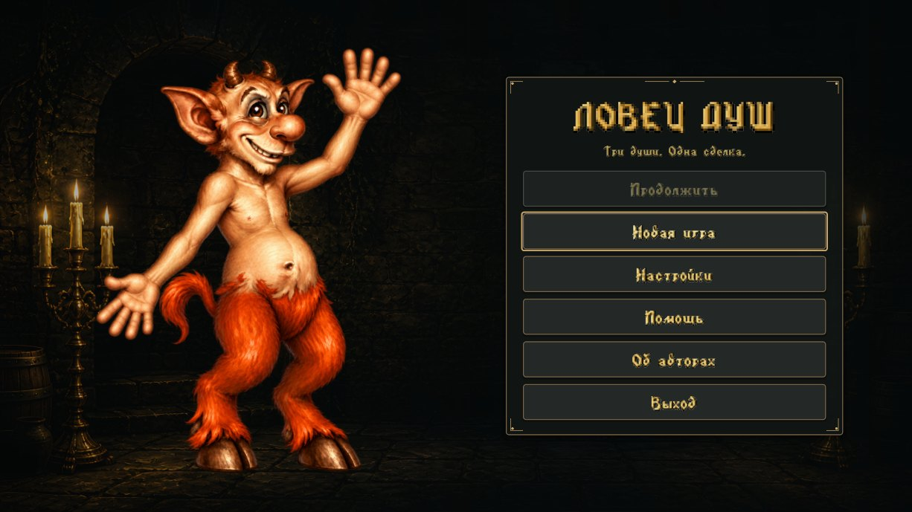
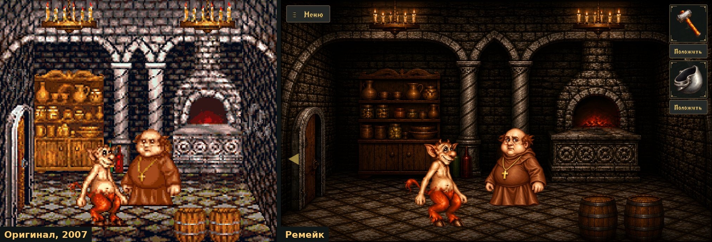
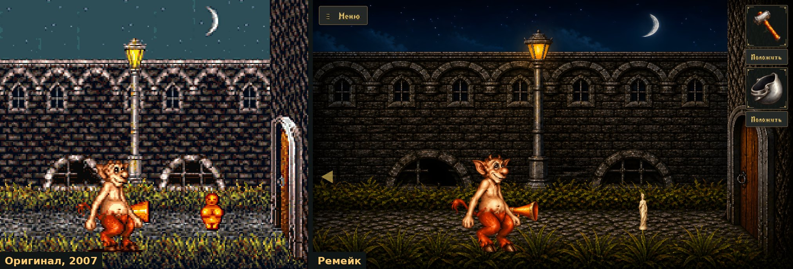
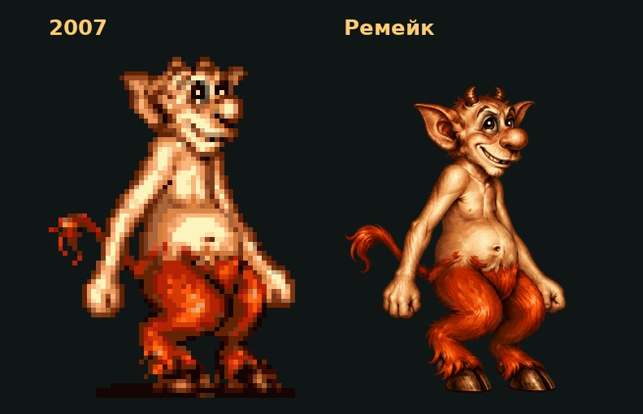
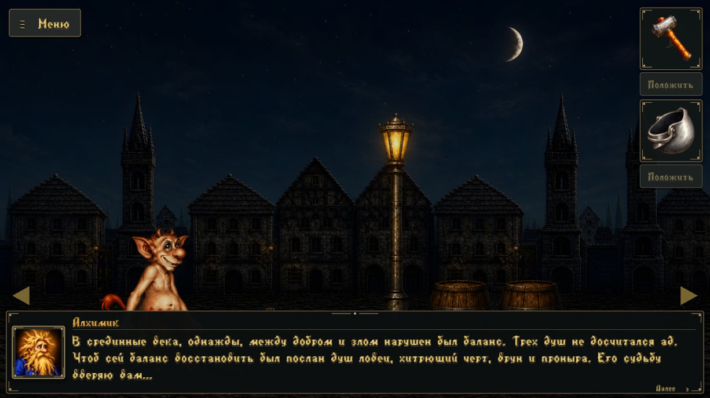

<div align="center">

# Ловец душ

**Ремейк мобильного квеста 2007 года для Android**

*«В срединные века, однажды, между добром и злом нарушен был баланс. Трёх душ не досчитался ад…»*




</div>

---

## Об оригинале

**«Ловец душ»** (SoulCatcher) — Java-квест для кнопочных телефонов, выпущенный в 2007 году
российской студией **Dynamic Pixels**. Годы спустя та же студия сделала *Hello Neighbor*.

Игра шла на экране 240×320: пиксельная графика, управление джойстиком и софт-клавишами,
а вся игра умещалась в JAR меньше 300 КБ и обходилась без звука. Внутри — 30 комнат средневекового города
и монастыря, десяток обитателей и много стихотворных шуток.

Герой — мелкий чёрт, «хитрющий, врун и проныра», которого ад отправил на землю за тремя
недостающими душами. Чтобы добыть **Донну Анну**, **Чернокнижника** и **Послушника**, ему
придётся обхитрить настоятеля, инквизитора, палача, алхимика и даже корову. Выменивать
предметы, выслушивать монахов и иногда что-нибудь взрывать.

Сегодня в оригинал можно поиграть разве что в эмуляторе J2ME. Этот проект возвращает его
на современные телефоны.

## Что это за проект

Это фанатский ремейк, а не эмуляция. Оригинальный JAR полностью разобран: тексты, карта мира,
предметы, диалоги и все скрипт-события выгружены прямо из кода игры и перенесены на Godot
без пересказа. Поэтому **сюжет, загадки и решения совпадают с оригиналом один в один**.
Заново сделано всё, что видит и слышит игрок.

### Было и стало





<div align="center">

</div>

## Сравнение

| | Оригинал (2007) | Ремейк |
|---|---|---|
| **Платформа** | J2ME, кнопочные телефоны | Android, Godot 4.7 |
| **Экран** | 240×320, портрет | Альбомный, 16:9 – 21:9, до 2560×1440 |
| **Графика** | Пиксель-арт из тайлов | Перерисованные нейросетью фоны и персонажи, HD и QHD |
| **Управление** | Джойстик и софт-клавиши | Касания: идти, подойти и поговорить, взять, положить |
| **Озвучка** | Нет | 171 реплика, 12 голосов |
| **Звук** | Нет | 3 музыкальные темы, атмосфера улицы, монастыря и костра, 9 эффектов |
| **Сохранения** | Запись в память телефона | Автосохранение с резервной копией, «Продолжить» с любого места |
| **Шрифт** | Растровый | Тот же оригинальный: 155 глифов, недостающие буквы собраны из его же штрихов |
| **Сюжет и загадки** | — | Без изменений |

## Что добавлено

**Графика**
- 30 перерисованных комнат, расширенных под широкий экран без растяжения персонажей.
- Чёрт — 33 кадра анимации, семь NPC — 85 кадров, 32 иконки предметов, 10 портретов для диалогов.
  Каждый кадр подогнан к оригиналу по росту, положению ног и центру масс, чтобы анимация не «плыла».
- Мягкие тени под персонажами, огонь и искры у костра, дым, пылинки в помещениях, туман на кладбище,
  свечение душ, мерцание свечей, люстр и фонарей.
- Три режима качества: «Максимальное · 2К», «Высокое · Full HD» и «Экономное».

**Звук**
- Полная озвучка: вступление, все диалоги, скрипт-сцены и финал. Голоса выровнены по громкости.
- Во время речи музыка приглушается, при перелистывании реплики голос останавливается.
- Шаги в такт анимации копыт. Отдельная громкость для музыки, эффектов и голосов.

**Удобство**
- Главное меню, пауза, помощь, «Об авторах», подтверждение новой игры.
- Сохраняется всё: комната, инвентарь, души, позиция, открытый диалог и очередь событий.
  Запись атомарная, с резервной копией. Свернул игру — она сохранилась и замолчала.
- Кнопка «Положить» под каждым слотом инвентаря, системная кнопка «Назад» на Android.
- Ходьба на 30% медленнее оригинальной: на большом экране так комфортнее.

<div align="center">

</div>

## Сборка

Нужны **Godot 4.7** с шаблонами экспорта под Android и Android SDK (build-tools 35).

```bash
# Запустить на компьютере
godot --path game

# Прогнать все проверки: прохождение, сохранения, звук, графика, анимации, шрифт
python game/tests/run_checks.py

# Собрать APK (arm64)
godot --headless --path game --export-debug Android ../build/lovec_dush.apk
adb install -r build/lovec_dush.apk
```

Тест `game/tests/walkthrough.gd` проходит игру целиком на три души. Это главная проверка,
что после правок логики игра всё ещё проходима.

## Устройство проекта

```
game/
├── main.gd            логика оригинала: сцены, взаимодействия, события, ходьба
├── scripts/           меню, сохранения, звук, графика, эффекты, тени
├── shaders/
├── assets/
│   ├── game.json      мир, выгруженный из оригинала: 30 сцен, 35 NPC и хотспотов, 32 предмета, 234 строки
│   ├── sprites/       исходные спрайты (по ним считаются размеры и области нажатия)
│   ├── hd/  qhd/      перерисованная графика, Full HD и 2К
│   ├── audio/         голоса, музыка, эффекты
│   └── fonts/         оригинальный растровый шрифт
└── tests/             headless-проверки
```

Логика работает в координатах оригинала (комната 240×210, тик 50 мс). На экран всё выводится
с масштабом, поэтому поведение не меняется при любом разрешении.

## Права

Это **неофициальный некоммерческий фанатский проект**. Игра «Ловец душ», её сюжет, тексты,
персонажи и оригинальная графика принадлежат **Dynamic Pixels**. Ремейк не связан со студией
и не одобрен ею. Если вы правообладатель и против проекта — напишите, и он будет снят.

Новая графика и озвучка сделаны с помощью нейросетей на основе оригинальных материалов.
